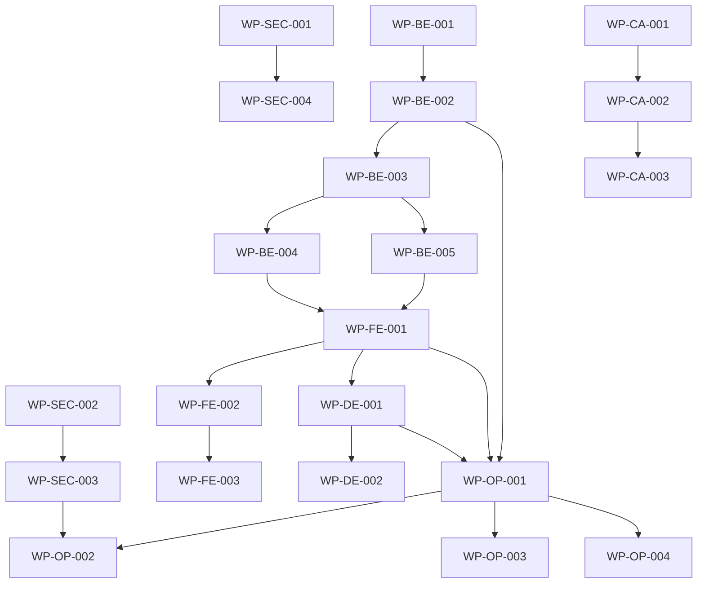

# Execution Plan — CFC Bot Manager

**Audit Date:** 2026-11-09  
**Auditor:** Autonomous Engineering Agent  
**References:** INITIAL-REPOSITORY-AUDIT.md, SECURITY-FINDINGS.md, IMPLEMENTATION-STATUS.md  
**Framework:** ZEAZ Engineering Execution Framework (ZEAZ-INTRODUCTION.md)  
**Governance:** AGENTS.md Repository Agent Contract

---

## 1. Plan Overview

This execution plan translates the audit findings and implementation status into an ordered, dependency-aware sequence of work packages. Each work package follows the ZEAZ lifecycle: **Discovery → Analysis → Plan → Implementation → Verification → Delivery**.

**Guiding Principles:**
- Audit first, then implement (AGENTS.md §11)
- Smallest reviewable changes (AGENTS.md §6)
- Evidence-based status claims (ZEAZ §44-54)
- Never weaken security/governance (AGENTS.md §4, §10)
- Independent review required for all merges (AGENTS.md §10, §13)

---

## 2. Work Package Definitions

### WP-SEC-001: Signing Key Rotation (P0)

| Aspect | Detail |
|--------|--------|
| **Trigger** | SEC-001: Historical passphrase exposure in Git history |
| **Owner** | Repository Administrator (requires admin permissions) |
| **Prerequisites** | None |
| **Scope** | External to codebase; coordination with all signers |
| **Tasks** | 1. Generate new GPG/SSH signing key pair 2. Distribute to authorized committers 3. Update CI/CD signing configuration 4. Revoke old key from trust stores 5. Document in CHANGELOG.md and security advisory |
| **Acceptance Criteria** | - New key in use for all signed commits/releases - Old key revoked - Rotation documented with timestamp |
| **Evidence Required** | - `gh api` verification of new key on commits - Revocation confirmation - CHANGELOG entry |
| **ZEAZ State Target** | `VERIFIED` (after admin confirmation) |
| **Blocking** | None (can run in parallel with code work) |

---

### WP-SEC-002: Configure Independent Reviewer (P0)

| Aspect | Detail |
|--------|--------|
| **Trigger** | SEC-002: `INDEPENDENT_REVIEWER` variable not set |
| **Owner** | Repository Administrator |
| **Prerequisites** | Identify valid, independent GitHub login (user or bot) |
| **Scope** | Repository variable configuration |
| **Tasks** | 1. Select independent reviewer (not a typical PR author) 2. Set variable: `gh variable set INDEPENDENT_REVIEWER --body "<login>" --repo cvsz/cfc-bot-manager` 3. Verify: `gh api repos/cvsz/cfc-bot-manager/variables --jq '.variables[] | select(.name=="INDEPENDENT_REVIEWER")'` |
| **Acceptance Criteria** | - Variable returns valid GitHub login - Workflow `request-independent-review.yml` validation passes |
| **Evidence Required** | - Variable readable via API - Test PR triggers review request |
| **ZEAZ State Target** | `VERIFIED` |
| **Blocking** | Required for WP-SEC-003 |

---

### WP-SEC-003: Enforce Independent Review in Branch Protection (P0)

| Aspect | Detail |
|--------|--------|
| **Trigger** | SEC-003: `verify-independent-approval` not in required status checks |
| **Owner** | Repository Administrator |
| **Prerequisites** | WP-SEC-002 complete (variable configured) |
| **Scope** | Branch protection rule update |
| **Tasks** | 1. Fetch current protection: `gh api repos/cvsz/cfc-bot-manager/branches/main/protection` 2. Update required contexts to include `verify-independent-approval` 3. Verify via API and test PR |
| **Acceptance Criteria** | - `verify-independent-approval` in `required_status_checks.contexts` - PR cannot merge without independent APPROVED review on exact head SHA |
| **Evidence Required** | - Updated branch protection JSON - Test PR blocked without independent review |
| **ZEAZ State Target** | `VERIFIED` |
| **Blocking** | WP-SEC-002 |

---

### WP-SEC-004: Enable Required Commit Signing (P1)

| Aspect | Detail |
|--------|--------|
| **Trigger** | SEC-004: `required_signatures.enabled: false` |
| **Owner** | Repository Administrator |
| **Prerequisites** | WP-SEC-001 complete (new signing keys distributed) |
| **Scope** | Branch protection rule update |
| **Tasks** | 1. Enable required signatures on main branch 2. Verify unsigned commits rejected |
| **Acceptance Criteria** | - `required_signatures.enabled: true` - Unsigned push to main fails |
| **Evidence Required** | - Branch protection API shows enabled - Failed push attempt log |
| **ZEAZ State Target** | `VERIFIED` |
| **Blocking** | WP-SEC-001 |

---

### WP-BE-001: Domain Entities & Repository Interfaces (P0)

| Aspect | Detail |
|--------|--------|
| **Trigger** | P1-04: No domain layer; blocks persistence & auth |
| **Owner** | Backend Engineer |
| **Prerequisites** | P1-01..03 complete (Go foundation verified) |
| **Scope** | New packages: `internal/domain/`, `internal/repository/` |
| **Tasks** | 1. Define core entities: `Organization`, `User`, `Membership`, `Role`, `Permission`, `Session`, `Room`, `Bot`, `Plugin`, `PluginConfig`, `AuditLog` 2. Define repository interfaces (Go interfaces) for each aggregate 3. Include tenant-scoped query signatures (e.g., `FindRoomsByOrg(orgID)`) 4. Write interface contract tests (mock-based) |
| **Acceptance Criteria** | - All entities defined with JSON/DB tags - Repository interfaces compile - Contract tests pass with mock implementations - No database code yet (interfaces only) |
| **Evidence Required** | - `go build ./...` passes - `go test -race ./internal/domain/... ./internal/repository/...` passes |
| **ZEAZ State Target** | `TESTED` |
| **Files to Create** | `internal/domain/*.go`, `internal/repository/*.go`, `internal/domain/*_test.go`, `internal/repository/*_test.go` |

---

### WP-BE-002: PostgreSQL Schema & Migrations (P0)

| Aspect | Detail |
|--------|--------|
| **Trigger** | P1-05: No persistence layer |
| **Owner** | Backend Engineer |
| **Prerequisites** | WP-BE-001 complete (interfaces defined) |
| **Scope** | New package: `internal/persistence/` + SQL migrations |
| **Tasks** | 1. Design normalized schema (see §3 for DDL outline) 2. Create migration files (versioned, timestamped) 3. Implement `pgx`/`database/sql` adapters for each repository interface 4. Add transaction management (BEGIN/COMMIT/ROLLBACK) 5. Write migration tests (up + down) 6. Add migration runner to startup (or CLI command) |
| **Acceptance Criteria** | - All migrations apply cleanly to empty DB - Rollback restores clean state - Repository adapters implement all interface methods - Integration tests pass against real PostgreSQL (testcontainers or local) - No plaintext passwords; use bcrypt/argon2 |
| **Evidence Required** | - Migration SQL files - `go test -race ./internal/persistence/...` passes - Testcontainers integration tests (or documented local DB test) |
| **ZEAZ State Target** | `TESTED` |
| **Files to Create** | `internal/persistence/*.go`, `migrations/*.sql`, `internal/persistence/*_test.go` |

---

### WP-BE-003: Authentication, Sessions, CSRF, MFA, RBAC (P0)

| Aspect | Detail |
|--------|--------|
| **Trigger** | P1-06, SEC-008: No auth implementation |
| **Owner** | Backend Engineer |
| **Prerequisites** | WP-BE-002 complete (persistence for users/sessions) |
| **Scope** | New package: `internal/auth/` + middleware in `internal/httpapi/` |
| **Tasks** | 1. Session management: secure cookies, rotation, expiry, revocation 2. Password hashing: argon2id (via `golang.org/x/crypto/argon2`) 3. Login/logout/password-reset endpoints 4. MFA: TOTP (RFC 6238) with backup codes 5. CSRF: double-submit cookie pattern for cookie-auth mutations 6. RBAC: role/permission matrix, resource-level checks 7. Authorization middleware: inject principal+tenant into request context 8. Audit logging for all privileged operations |
| **Acceptance Criteria** | - All auth endpoints covered by tests (unit + integration) - CSRF tokens required and validated for mutating cookie endpoints - MFA enforceable per role - Cross-tenant access denied (negative tests) - Session rotation on privilege change - Structured audit logs with correlation IDs |
| **Evidence Required** | - `go test -race ./internal/auth/... ./internal/httpapi/...` passes - Integration tests for login, MFA, CSRF, RBAC denial |
| **ZEAZ State Target** | `TESTED` |
| **Files to Create** | `internal/auth/*.go`, `internal/httpapi/auth_middleware.go`, `internal/auth/*_test.go` |

---

### WP-BE-004: Tenant Isolation Tests & CRUD Endpoints (P0)

| Aspect | Detail |
|--------|--------|
| **Trigger** | P1-07: Resource/tenant isolation tests required before CRUD |
| **Owner** | Backend Engineer |
| **Prerequisites** | WP-BE-003 complete (auth + persistence) |
| **Scope** | Test-first CRUD endpoints for Organizations, Rooms, Bots, Plugins |
| **Tasks** | 1. Write cross-tenant denial tests (negative cases) for each resource 2. Implement CRUD handlers with authorization checks 3. Add request validation (go-playground/validator or similar) 4. Add pagination, filtering, sorting to list endpoints 5. Add idempotency keys for mutations 6. OpenAPI spec generation (swaggo or manual) |
| **Acceptance Criteria** | - Every CRUD endpoint has authorization test (positive + negative) - Cross-tenant attempts return 403/404, never data - OpenAPI spec validates against handlers - Contract tests for API schemas |
| **Evidence Required** | - Test output showing denial cases pass - `go test -race ./internal/api/...` (or wherever handlers live) - Generated `openapi.yaml` |
| **ZEAZ State Target** | `TESTED` |

---

### WP-BE-005: WebSocket & Real-time Events (P1)

| Aspect | Detail |
|--------|--------|
| **Trigger** | Architecture §2.5, Requirements §23: WebSocket for live updates |
| **Owner** | Backend Engineer |
| **Prerequisites** | WP-BE-003 complete (auth middleware for WS upgrade) |
| **Scope** | New package: `internal/httpapi/ws.go` or similar |
| **Tasks** | 1. WebSocket upgrade endpoint with auth validation 2. Connection registry per tenant/user 3. Event types: bot status, room status, plugin config change, audit log 4. Reconnect/backoff guidance for clients 5. Message acknowledgment & ordering guarantees |
| **Acceptance Criteria** | - Authenticated WS connections only - Tenant-scoped event delivery - Unit tests for connection registry - Integration test: connect, subscribe, receive event |
| **Evidence Required** | - `go test -race` passes for WS package - Manual or automated WS test evidence |
| **ZEAZ State Target** | `TESTED` |

---

### WP-CA-001: Complete CamfrogAdapter Interface (P0)

| Aspect | Detail |
|--------|--------|
| **Trigger** | P2-01: Adapter interface incomplete; transport not separated |
| **Owner** | Backend Engineer (Protocol Specialist) |
| **Prerequisites** | P2-03 partial (RPC helpers exist) |
| **Scope** | Refactor `internal/camfrog/` into interface + transport implementations |
| **Tasks** | 1. Define `CamfrogAdapter` interface with capability model 2. Separate `JSONRPCTransport` and `MultipartTransport` 3. Add session handling (cookie jar, CSRF token extraction) 4. Add context cancellation & timeout propagation 5. Define capability registry (verified vs observed vs unsupported) 6. Keep `rpc.go` helpers as transport-internal |
| **Acceptance Criteria** | - Interface compiles without transport deps - Transport implementations swappable - All existing RPC tests still pass - New capability model tests pass |
| **Evidence Required** | - `go build ./internal/camfrog/...` passes - `go test -race ./internal/camfrog/...` passes |
| **ZEAZ State Target** | `TESTED` |
| **Files to Modify** | `internal/camfrog/rpc.go` → split into `adapter.go`, `transport_jsonrpc.go`, `transport_multipart.go`, `capability.go`, `session.go` |

---

### WP-CA-002: Contract Fixtures & Fake Server Tests (P1)

| Aspect | Detail |
|--------|--------|
| **Trigger** | P2-04: No sanitized fixtures or contract tests |
| **Owner** | Backend Engineer |
| **Prerequisites** | WP-CA-001 complete (interface defined) |
| **Scope** | New directories: `camfrog/contracts/`, `camfrog/compatibility/` |
| **Tasks** | 1. Create sanitized JSON RPC request/response fixtures (no cookies, sessions, room keys) 2. Create multipart form fixtures for plugin settings 3. Implement fake HTTP server for contract testing 4. Write contract tests: adapter produces valid requests, handles valid/invalid responses 5. Document capability matrix per product/version |
| **Acceptance Criteria** | - Fixtures contain no secrets - Contract tests pass against fake server - Capability matrix matches `plugin-compatibility-matrix.md` |
| **Evidence Required** | - Fixture files in `camfrog/contracts/` - `go test -race ./camfrog/...` passes |
| **ZEAZ State Target** | `TESTED` |

---

### WP-CA-003: Authorized Integration Tests (P0) — BLOCKED

| Aspect | Detail |
|--------|--------|
| **Trigger** | P2-05: Verify protocol behavior in authorized environment |
| **Owner** | Backend Engineer |
| **Prerequisites** | WP-CA-002 complete; authorized Camfrog test account & environment |
| **Scope** | External dependency — cannot proceed without access |
| **Tasks** | 1. Obtain authorized test credentials (never committed) 2. Run integration tests against live Camfrog endpoint 3. Record success/failure cases, timeout behavior, session expiry 4. Update capability matrix with `VERIFIED` status per product/version |
| **Acceptance Criteria** | - Integration tests pass in authorized environment - Capability matrix updated with evidence |
| **Evidence Required** | - Test run logs (sanitized) - Updated `plugin-compatibility-matrix.md` |
| **ZEAZ State Target** | `BLOCKED` (external dependency) |
| **Note** | Per ZEAZ §44-54: mark `BLOCKED` when concrete external prerequisite prevents verification |

---

### WP-FE-001: Web Control Panel Foundation (P1)

| Aspect | Detail |
|--------|--------|
| **Trigger** | P3-01: No frontend code |
| **Owner** | Frontend Engineer |
| **Prerequisites** | WP-BE-004 complete (API contracts stable), WP-BE-005 (WS) |
| **Scope** | New: `apps/web/`, `packages/contracts/`, `packages/client/`, `packages/ui/` |
| **Tasks** | 1. Initialize React + TypeScript + Vite project 2. Generate TypeScript types from OpenAPI spec 3. Create typed API client (TanStack Query or SWR) 4. Set up shared UI component library (Radix UI + Tailwind or similar) 5. Configure ESLint, Prettier, TypeScript strict mode 6. Add Vitest + React Testing Library + Playwright for e2e |
| **Acceptance Criteria** | - `npm run build` passes - `npm run test` passes - `npm run lint` passes - TypeScript strict mode no errors |
| **Evidence Required** | - CI workflow for frontend (new `.github/workflows/frontend.yml`) - Build/test/lint output |
| **ZEAZ State Target** | `TESTED` |

---

### WP-FE-002: Authentication & Route Guards (P1)

| Aspect | Detail |
|--------|--------|
| **Trigger** | P3-02: No frontend auth |
| **Owner** | Frontend Engineer |
| **Prerequisites** | WP-FE-001 complete; WP-BE-003 (backend auth endpoints) |
| **Scope** | `apps/web/src/auth/`, route protection |
| **Tasks** | 1. Login/logout/password-reset/MFA pages 2. Token storage (secure, httpOnly cookie via backend) 3. Route guards: redirect unauthenticated to login 4. Role-based route access (client-side mirror of server RBAC) 5. Session expiry handling (auto-refresh or redirect) |
| **Acceptance Criteria** | - All protected routes redirect to login when unauthenticated - MFA flow works end-to-end - Role-based UI elements hidden correctly |
| **Evidence Required** | - Component tests + Playwright e2e tests |
| **ZEAZ State Target** | `TESTED` |

---

### WP-FE-003: Core Dashboard & Inventory Views (P1)

| Aspect | Detail |
|--------|--------|
| **Trigger** | P3-03: No UI for bots, rooms, plugins |
| **Owner** | Frontend Engineer |
| **Prerequisites** | WP-FE-002 complete |
| **Scope** | `apps/web/src/pages/` — Dashboard, Bots, Rooms, Plugins, Users, Audit, Settings |
| **Tasks** | 1. Dashboard: health summary, recent activity, quick actions 2. Bot list/detail: status, connection, start/stop (where supported) 3. Room list/detail: config, access key handling (masked), diagnostics 4. Plugin inventory: capability matrix, config forms (only VERIFIED), import/export 5. User/role management: CRUD, assignments 6. Audit history: paginated, filterable 7. WebSocket status indicators (live badges) |
| **Acceptance Criteria** | - All views fetch from API, handle loading/error/empty states - Plugin config forms only for `VERIFIED` capabilities - Accessible (WCAG 2.1 AA): labels, focus, contrast, keyboard - Responsive layouts (mobile → desktop) |
| **Evidence Required** | - Component tests, accessibility audit (axe-core), visual regression |
| **ZEAZ State Target** | `TESTED` |

---

### WP-DE-001: Tauri 2 Desktop Foundation (P1)

| Aspect | Detail |
|--------|--------|
| **Trigger** | P4-01: No desktop app |
| **Owner** | Desktop Engineer |
| **Prerequisites** | WP-FE-001 complete (shared packages) |
| **Scope** | New: `apps/desktop/` (Tauri 2 + React + TypeScript) |
| **Tasks** | 1. Initialize Tauri 2 project (`cargo tauri init`) 2. Configure `tauri.conf.json` with minimal capabilities 3. Share `packages/contracts`, `packages/client`, `packages/ui` via workspace 4. Set up Rust backend commands for desktop-specific features 5. Configure build pipeline (GitHub Actions + `tauri-action`) |
| **Acceptance Criteria** | - `cargo tauri build` produces signed `.msi`/`.exe` - Dev mode: `cargo tauri dev` works - Shared packages compile for both web and desktop |
| **Evidence Required** | - Build artifacts - CI workflow for desktop (new `.github/workflows/desktop.yml`) |
| **ZEAZ State Target** | `TESTED` |

---

### WP-DE-002: Desktop-Specific Features (P1)

| Aspect | Detail |
|--------|--------|
| **Trigger** | P4-03, P4-04: Secure storage, OS notifications, minimal capabilities |
| **Owner** | Desktop Engineer |
| **Prerequisites** | WP-DE-001 complete |
| **Scope** | Tauri commands, capabilities, secure storage |
| **Tasks** | 1. Secure token storage: Tauri Keyring plugin (OS-backed) 2. Desktop notifications: `tauri-plugin-notification` 3. Local diagnostics: log viewer, connection test, config export 4. File system access: only explicit user-selected paths (dialog) 5. Capability model: least privilege — no `allow-all`, explicit `fs:read`, `dialog:open`, `notification:show` |
| **Acceptance Criteria** | - Tokens survive app restart (keyring) - Notifications appear for bot events - Capability audit: `cargo tauri info` shows minimal permissions - No backend secrets in desktop bundle |
| **Evidence Required** | - Capability manifest review - Security permission test results |
| **ZEAZ State Target** | `TESTED` |

---

### WP-OP-001: Docker Compose & Local Dev Environment (P1)

| Aspect | Detail |
|--------|--------|
| **Trigger** | P5-01: No multi-service dev environment |
| **Owner** | DevOps Engineer |
| **Prerequisites** | WP-BE-002 (PostgreSQL), WP-FE-001 (web build), WP-DE-001 (desktop build) |
| **Scope** | `deployments/docker/docker-compose.yml` + `.env.example` updates |
| **Tasks** | 1. Services: postgres, backend, frontend (nginx/static), optional: mailhog, redis 2. Health checks for all services 3. Volume persistence for postgres 4. `.env.example` with all required variables (placeholders) 5. `make dev-up` / `make dev-down` targets |
| **Acceptance Criteria** | - `docker compose up -d` starts all services healthy - Backend connects to postgres - Frontend accessible via localhost - `make ci` passes in container |
| **Evidence Required** | - `docker compose ps` output - Service logs showing readiness |
| **ZEAZ State Target** | `TESTED` |

---

### WP-OP-002: CI/CD Enhancement (P1)

| Aspect | Detail |
|--------|--------|
| **Trigger** | P5-02, SEC-005, SEC-006, SEC-010: Incomplete CI |
| **Owner** | DevOps Engineer |
| **Prerequisites** | WP-OP-001 (compose for CI services) |
| **Scope** | `.github/workflows/ci.yml`, new workflows |
| **Tasks** | 1. Add `govulncheck` job to CI 2. Add `gosec` job to CI 3. Add frontend CI workflow (lint, typecheck, test, build) 4. Add desktop CI workflow (cargo check, test, build) 5. Add SBOM generation job (anchore/sbom-action) 6. Attach SBOM to releases 7. Pin all new actions to SHAs |
| **Acceptance Criteria** | - All jobs pass on main and PRs - SBOM attached to release assets - Go vulnerability scan fails on HIGH/CRITICAL - `gosec` finds no HIGH severity issues |
| **Evidence Required** | - CI run logs - Release assets include SBOM |
| **ZEAZ State Target** | `VERIFIED` (requires exact-head CI green) |

---

### WP-OP-003: Backup/Restore & Migration Rollback (P1)

| Aspect | Detail |
|--------|--------|
| **Trigger** | P5-04: No operational procedures |
| **Owner** | DevOps Engineer |
| **Prerequisites** | WP-BE-002 (migrations), WP-OP-001 (postgres in compose) |
| **Scope** | `scripts/backup.sh`, `scripts/restore.sh`, `docs/operations/backup-restore.md` |
| **Tasks** | 1. Backup script: `pg_dump` with compression, encryption option 2. Restore script: `pg_restore` with verification 3. Migration rollback test: apply + rollback each migration 4. Document RPO/RTO targets 5. Add to CI: test backup/restore cycle on test DB |
| **Acceptance Criteria** | - Backup produces valid dump - Restore recovers data to point-in-time - All migrations rollback cleanly - Documentation includes procedures |
| **Evidence Required** | - Script output logs - CI test passing |
| **ZEAZ State Target** | `TESTED` |

---

### WP-OP-004: Observability & Runbooks (P2)

| Aspect | Detail |
|--------|--------|
| **Trigger** | P5-05: No ops documentation |
| **Owner** | DevOps Engineer |
| **Prerequisites** | WP-OP-001 (deployed stack) |
| **Scope** | `docs/operations/` — deployment.md, troubleshooting.md, monitoring.md |
| **Tasks** | 1. Structured logging: correlation IDs, log levels, redaction 2. Metrics: Prometheus endpoints (Go `promauto`) 3. Health/readiness probes for k8s 4. Alerting rules (high error rate, DB connectivity, queue lag) 5. Deployment runbook: blue/green or rolling 6. Rollback runbook: DB migration + binary 7. Incident response: detection → containment → recovery |
| **Acceptance Criteria** | - Logs include correlation IDs across requests - Metrics scrapeable - Runbooks tested in staging |
| **Evidence Required** | - Log samples, metrics output, runbook documents |
| **ZEAZ State Target** | `TESTED` |

---

## 3. Dependency Graph (Critical Path)

**Critical Path (Longest Dependency Chain):**
`WP-BE-001 → WP-BE-002 → WP-BE-003 → WP-BE-004 → WP-FE-001 → WP-FE-002 → WP-FE-003`  
Estimated: **8-12 work packages sequential** for first full vertical slice.

**Parallelizable Tracks:**
- Security track (WP-SEC-*) — independent, admin-only
- Protocol adapter track (WP-CA-*) — can start after WP-BE-001
- DevOps track (WP-OP-*) — starts after WP-OP-001

---

## 4. Resource Allocation (Suggested)

| Role | Work Packages | Max Concurrent |
|------|---------------|----------------|
| Repository Admin | WP-SEC-001, WP-SEC-002, WP-SEC-003, WP-SEC-004 | 1 (sequential) |
| Backend Engineer | WP-BE-001 → WP-BE-005, WP-CA-001 → WP-CA-002 | 2 (BE + CA parallel after WP-BE-001) |
| Frontend Engineer | WP-FE-001 → WP-FE-003 | 1 |
| Desktop Engineer | WP-DE-001 → WP-DE-002 | 1 |
| DevOps Engineer | WP-OP-001 → WP-OP-004 | 1 |

**Total Max Concurrent Agents:** 4 (per AGENTS.md §12)

**File Ownership Boundaries:**
- Backend: `backend/**`, `internal/**`, `migrations/**`, `camfrog/**`
- Frontend: `apps/web/**`, `packages/**`
- Desktop: `apps/desktop/**`
- DevOps: `.github/workflows/**`, `deployments/**`, `scripts/*.sh`, `docs/operations/**`
- Security: Admin-only (repository settings, variables, keys)

---

## 5. Verification Gates (Per Work Package)

Each work package must satisfy these gates before marking `VERIFIED`:

| Gate | Requirement |
|------|-------------|
| **Code Complete** | All implementation files created/modified |
| **Tests Written** | Unit + integration tests for new behavior |
| **Tests Pass Local** | `go test -race ./...` / `npm test` / `cargo test` |
| **Tests Pass CI** | Exact-head CI green on PR |
| **Security Review** | No new secrets, no weakened controls, authz on all endpoints |
| **Independent Review** | `verify-independent-approval` passes on PR head SHA |
| **Documentation Updated** | Architecture, API, operations docs reflect changes |
| **No Regression** | All existing tests still pass |

---

## 6. Immediate Next Actions (Week 1)

| Priority | Action | Owner | Blockers |
|----------|--------|-------|----------|
| 1 | Rotate signing key (WP-SEC-001) | Repo Admin | None |
| 2 | Set INDEPENDENT_REVIEWER variable (WP-SEC-002) | Repo Admin | None |
| 3 | Add verify-independent-approval to branch protection (WP-SEC-003) | Repo Admin | #2 complete |
| 4 | Design domain entities & repository interfaces (WP-BE-001) | Backend Eng | None |
| 5 | Complete CamfrogAdapter interface (WP-CA-001) | Backend Eng | None (parallel) |

---

## 7. Risk Register

| Risk | Likelihood | Impact | Mitigation |
|------|------------|--------|------------|
| Authorized Camfrog test environment unavailable | HIGH | Blocks WP-CA-003 (VERIFIED capabilities) | Mark BLOCKED; ship with UNVERIFIED only; document clearly |
| Signing key rotation breaks CI signing | MEDIUM | Blocks releases | Test in staging first; coordinate with all signers |
| Independent reviewer unavailable | MEDIUM | Blocks all merges | Configure bot account as fallback; document escalation |
| PostgreSQL migration conflicts in parallel dev | LOW | Data loss risk | Migration locking; sequential apply; test rollback |
| Tauri 2 API changes (pre-stable) | LOW | Build breaks | Pin Tauri version; test upgrades in branch |
| Go 1.24+ breaks compatibility | LOW | Build breaks | Go version pinned in go.mod; test upgrades |

---

## 8. Communication & Handoff

Per ZEAZ §42 and AGENTS.md §12:
- Each agent maintains work ledger in `IMPLEMENTATION-STATUS.md`
- Handoff document (`core_handoff_write`) at end of each session
- Conflicting recommendations reconciled before applying changes
- Evidence cited for all claims; distinguish `IMPLEMENTED` vs `VERIFIED`

---

**Plan Status:** `ACTIVE` — Ready for execution  
**Next Review:** After Week 1 actions complete  
**Authorization:** Repository administrators must approve WP-SEC-001 through WP-SEC-004 before merge